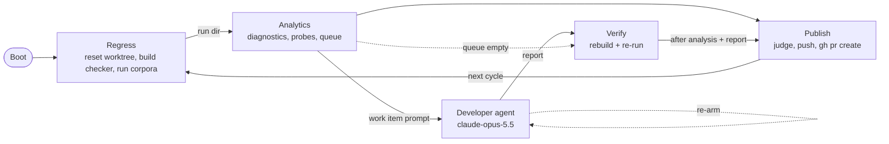

# Z3-pulse-loop: autonomous Pulse/F* checker development loop

A never-terminating [Junco](https://github.com/elefthei/junco) workflow that keeps improving the
F*/Pulse "twin" proof checker under `fstar/` and opens one pull request per accepted improvement
against `elefthei/z3` (`loop/junco-N` branches, base `master`).

The loop is the graph itself: `wf.yml` is one cycle `Regress → … → Publish → Regress` that never
terminates; `wf.ts` builds it once and owns the deterministic steps.



`Boot` exists because a cycle has no entry node of its own. The Developer is one agent session that
runs once per assignment: `Developer -> Developer` re-arms the returned node and the `available`
hook in `wf.ts` stages the next assignment as its prompt (the mechanism of `schedules.ralph`); Pi's
auto-compaction keeps the session bounded. On an empty queue Analytics bypasses the Developer,
and Publish pauses 10 minutes before the next cycle. A master that does not build is retried by
Regress after the same pause.

## What one cycle does

1. **Regress** (code). Resets the loop worktree to `origin/master`, builds the native checker with
   `fstar/tools/build_ocaml_checker.ps1 -RunTests` (the same command as
   `.github/workflows/pulse-checker-regressions.yml`) and runs both corpora of
   [Z3Prover/z3test](https://github.com/Z3Prover/z3test) through `fstar/tools/run_checker_regressions.py`
   (`regressions/proofs`, `regressions/smtlib-sample`). Results are cached per master SHA under
   `<state>/baseline/<sha>/`.
2. **Analytics** (code). Parses `results.jsonl` and the per-case `--stats` lines, re-runs every
   `PARTIAL`/`REJECT` case with `--diagnostics` to get the pending `obligation <rule> <count> <first> <shape>`
   rows, counts `Lemma`/`assume`/`admit` markers in `fstar/*.fst*`, records the probes below, rebuilds
   `<state>/queue.json` and assigns the next open item to the Developer.
3. **Developer** (agent, `read bash edit grep find` inside the worktree). Implements the item: cover an
   obligation family, fix a `REJECT`/crash/timeout, make z3's proof hints more specific (`src/`), or speed
   up a slow case. It may not add `admit`/`assume`, commit or push.
   Every shell command runs under `ulimit -t 1800` (30 CPU-minutes per process; a runaway analysis
   script once stalled an iteration for hours).
4. **Verify** (code). Rebuilds and re-runs the corpora on the modified tree into `<state>/runs/<n>/after/`.
5. **Publish** (code). Deterministic judge: build and F*/Pulse regressions pass, no `ACCEPT`→worse or
   `PARTIAL`→worse case, no new `assume`/`admit`, and the targeted item (or the corpus as a whole) improved.
   A case that was already at ≥80% of the 60 s case or 10 s solver budget and now reports `TIMEOUT`/`UNKNOWN`
   counts as noise, not a regression. The attempt is always saved as `<state>/runs/<n>/attempt.patch`.
   Accepted: commit, push `loop/junco-N`, `gh pr create` with the Developer's report plus a before/after
   analytics table. Rejected: the reason, the patch path and the Developer's report are appended to the
   item's notes so the next attempt can start from them.

The runner repeats forever. An empty queue or a master that does not build pauses 10 minutes before the
next attempt. Any other iteration failure exits the process (the native tool runtime stays poisoned after
a tokio worker panic; observed once as `OS can't spawn worker thread: EAGAIN` under a load-190 build) and
`bun run loop` starts a fresh one 60 s later; the iteration counter, queue and caches are on disk.

## Work queue (`<state>/queue.json`)

Rebuilt from every baseline run; `attempts`, `notes` and `pr` of surviving items are kept.

| kind | one item per | priority |
|---|---|---|
| `crash` | case with `ERROR`/`CRASH`/`PROTOCOL_ERROR` | 1 |
| `reject` | `REJECT` diagnostic stage | 2 |
| `obligation` | `(rule, shape)` family of pending proof steps | 3 |
| `timeout` | `TIMEOUT` case | 4 |
| `slow` | top-5 `check_ms` cases | 5 |

Order: fewest failed attempts first (so failures rotate through the queue), then kind priority, then larger weight (pending count / cases / ms).

## Analytics

Every analysis (`before` = node `Analytics`, `after` = node `Verify`) emits these probes to Grafana
(`junco_probe_value{node,edge_id}` on dashboard `Z3-pulse-loop`), appends one JSON line to
`<state>/analytics.jsonl`, and lands in the PR body:

`build_ok tested accept partial reject timeout errors proof_steps_total proof_steps_pending
proof_steps_checked obligation_families check_ms_total solve_ms_total fstar_lemmas fstar_assumed
queue_open queue_pr pr_opened iteration`

One process run is one Opik trace (`Z3-pulse-loop <start time>`, project `Z3-pulse-loop`) with every
cycle's node spans and the Developer's full agent transcript; the `iteration` probe and the
`iteration N:` log lines separate cycles.

## Running

Prerequisites (all present on this machine as of 2026-11-05):

- `bun`, `pwsh`, `cmake`, `g++`, `libgmp-dev`, `python3`, `btrfs-progs`, and `gh` with a login for the repo
  owner (`elefthei`; push and `gh pr create` run with `gh auth token --user elefthei`, whatever the active account is)
- F* `v2026.09.27` at `/opt/fstar-v2026.09.27` (the CI pin; the 2026-11-05 nightly rejects `Z3PulseLraChecker.fst`)
- opam's default switch (`opam switch show`) on OCaml 5.3.0 with `ocamlfind`, `zarith`
- a btrfs mount with `user_subvol_rm_allowed` for the state dir (Junco's agent tools run in a btrfs seed)
- a saved Pi `github-copilot` login; Opik at `http://localhost:5173` and the Grafana bridge at `http://localhost:8000`
- the `junco` checkout with its `node_modules` (default `~/git/junco`; override `JUNCO=...`)

```sh
cd .junco/Z3-pulse-loop
bun run link      # symlinks junco, dataflow-engine(-opik), opik, pi-* into node_modules
bun run check     # offline: YAML/roles/ladder validation + queue/judge self-checks + tsc
bun run loop      # forever, as a plain user process; restarts wf.ts after a crash; Ctrl-C stops after the current step
```

Environment: `Z3_PULSE_LOOP_REPO` (`~/git/z3`), `Z3_PULSE_LOOP_STATE` (`/btrfs/Z3-pulse-loop`),
`FSTAR_EXE`, `Z3_PULSE_LOOP_MAX_CASES` (0 = whole corpora),
`GRAFANA_URL`, `OPIK_URL_OVERRIDE`, `OPIK_PROJECT_NAME`.

State layout: `worktree/` (btrfs subvolume, git worktree of `Z3_PULSE_LOOP_REPO`), `z3test/`,
`baseline/<sha>/`, `runs/<n>/{after,pr.md}`, `queue.json`, `analytics.jsonl`, `iteration`,
`z3-build/`, `z3-install/`, `fstar-cache/`, `checker/`.

## Changing the loop

- Judge thresholds and queue ranking: `judge`, `refreshQueue`, `pickItem` in `wf.ts`; `wf.check.ts` pins them.
- Developer role and rules: `system:` of node `Developer` in `wf.yml`.
- Model: `DEVELOPER` ladder in `wf.ts` (re-verify against the Pi catalog when changing).
